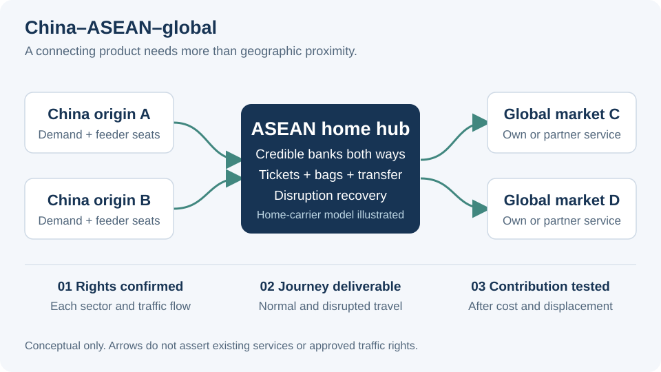

Draw China on one side of a presentation, an ASEAN hub in the middle, and overseas destinations on the other. The arrows are easy. The hard part is proving that enough passengers will buy the connection, that the traffic rights support the operator, and that the network can recover when an inbound misses the onward flight.

For a regional airline, a cross-border hub can broaden the market beyond local demand. It can also introduce a long-haul aircraft commitment supported by feeder traffic that exists only in a spreadsheet.

The useful evaluation unit is the complete origin-and-destination journey. Geography is one input; operating authority, commercial access, schedules, and reliability determine whether the journey becomes a product.

## 1. Identify whose hub it is

There are several materially different strategies behind a China–ASEAN–global diagram.

| Model | Operating structure | Main question |
|---|---|---|
| Home-country hub | An ASEAN carrier connects China and another foreign market through its home State | Do the authorities and economics support both sides of the network? |
| Partner gateway | A regional carrier feeds an onward partner at an ASEAN airport | Is the connection commercially and operationally implemented? |
| Intermediate stop | A carrier operates through an ASEAN point en route to another country | Which traffic may it carry on each sector? |
| Self-transfer gateway | Customers combine independently sold flights | Can they meet entry, baggage, check-in, and recovery requirements? |

These models should have separate business cases. Owning an onward aircraft creates a different financial exposure from buying access through an interline partner. A self-transfer itinerary places different responsibilities on the passenger from a supported through journey.

The earlier [network-model comparison](/posts/hub-and-spoke-vs-point-to-point-southeast-asia/) covered hub, point-to-point, and hybrid structures. Cross-border traffic adds another layer: the customer's journey crosses multiple regulatory and service boundaries, even when the airline presents one itinerary.

## 2. Resolve traffic rights before forecasting feed

An ASEAN home carrier transporting passengers from China through its own State to another foreign country is conventionally described as carrying sixth-freedom traffic. ICAO's [WASA explanatory notes](https://wasa.icao.int/aboutwasa/wasaexplanatorynotes) describe this as a combination of third- and fourth-freedom rights through the carrier's home State.

The same geography does not give every airline the same rights. A carrier using a hub outside its home State cannot simply apply that home-hub explanation. An intermediate-stop operation carrying local traffic between foreign States raises fifth-freedom questions; a stand-alone foreign-to-foreign operation raises a different rights question again. Analyse the operating carrier, route structure, and traffic being uplifted.

The [ASEAN–China agreement and protocols](https://asean.org/countrypartners/china/) provide an important framework, including instruments for third, fourth, and fifth freedoms. They do not establish unrestricted rights from any Chinese city through any ASEAN point to every global destination. Check the relevant instruments, participation, designation, route entitlements, and the onward market separately.

The planning output should be a rights matrix with a row for each physical sector and traffic flow. Mark confirmed authority, pending authority, and unsupported assumptions explicitly. A pending market should not contribute the same probability-weighted feed as a confirmed one without explanation.

## 3. Design a bank that passengers can actually use

A hub bank concentrates arrivals ahead of departures. Its commercial advantage is the number of useful connections, rather than the number of lines on the map.

Consider this constructed example. All times are UTC, on the same day, and the assumed applicable minimum connection is 90 minutes. These are not schedules or MCTs for any actual airport.

| Inbound arrival at hub | Onward departure 08:20 | Onward departure 09:10 |
|---|---|---|
| China origin A: 05:50 | 2h 30m connection | 3h 20m connection |
| China origin B: 06:20 | 2h connection | 2h 50m connection |
| China origin C: 07:40 | 40m: below assumed minimum | 1h 30m: meets assumed minimum |

Six theoretical combinations produce five connections meeting the assumed minimum. The connection at exactly 90 minutes has no scheduled margin above that minimum. Actual assessment must use the relevant carrier, terminal, and itinerary records, as described in [IATA's MCT technical guide](https://www.iata.org/contentassets/638f0938b3dd451b872a1d8357755421/minimum-connecting-time-technical-guide_version-2.1.pdf).

Repeat the exercise in reverse. An attractive outbound connection is insufficient if the return journey requires an overnight stay that the target market will not accept. Build dates and time zones into the calculation; a departure after midnight may belong to the following operating day.

## 4. Feeder seats are not the same as connecting demand

Suppose three China-origin services contribute 30, 25, and 20 passengers to an onward departure. The combined feed is 75 passengers. If the onward aircraft has 240 seats, that feed fills 31.25% of capacity. The remaining seats still need support from local traffic, other feeders, or an acceptable operating result at a lower load.

Every number in that example is hypothetical. Its purpose is to expose the denominator. Counting three feeder flights does not establish enough demand for a wide-body departure.

Build feed estimates by origin, destination, direction, travel date, and fare. Then apply realistic capture assumptions. The total size of a China–overseas market is not the volume available to a new one-stop competitor.

Passengers will compare the complete offer: fare, duration, connection risk, baggage, refund terms, and frequency. Some markets tolerate a longer journey for a lower fare; others will pay to avoid a connection. Those differences should appear in segment assumptions, rather than a single capture rate applied to every market.

Avoid counting a passenger once as local demand and again as connecting demand on the same sector. Keep passenger journeys and occupied flight seats as related but distinct records.

## 5. Transfer capability is an airport-specific product

International airport status does not establish every proposed transfer process. Check whether the intended passenger can stay airside, whether boarding passes can be issued, how baggage moves, and whether terminal or security changes apply.

Singapore provides a useful official example of the distinction. The [Immigration & Checkpoints Authority](https://www.ica.gov.sg/information-and-e-services/entry-and-departure/entering-singapore/transit-through-singapore) distinguishes passengers remaining in transit from those entering to collect bags or obtain onward boarding passes. [Changi's transit guidance](https://www.changiairport.com/en/fly/transit-guide.html) also makes itinerary and baggage arrangements relevant. These are examples from one gateway, rather than a template for every ASEAN airport.

For the proposed hub, obtain a documented process from the airport, handlers, and relevant authorities. Walk through at least four passenger cases: through-ticket with baggage, through-ticket without baggage, separate tickets, and a disrupted passenger requiring an overnight stay.

The last case can reveal a weakness hidden by the normal transfer process. A passenger permitted to remain airside for a short connection may have different requirements when a cancellation requires entry and accommodation.

## 6. Choose a partnership model before committing aircraft

The [interline and codeshare article](/posts/codeshare-and-interline-agreements/) explained the difference between contractual reach and an implemented journey. For a cross-border hub, that distinction determines whether forecast feed is sellable.

A regional carrier can test selected connecting markets through a partner before taking on the cost of an entire long-haul operation. That approach trades some control and revenue for a smaller capacity commitment. It still requires inventory access, acceptable revenue allocation, ticketing, baggage arrangements, and disruption handling.

An own-metal strategy offers control over the bank and product, but the carrier carries the aircraft, crew, maintenance, and network-recovery obligations. It should be justified against the partnership alternative using consistent demand and cost assumptions.

A useful sequence is to prove one or two journeys, measure actual uptake and net revenue, and then assess expansion. A smaller test cannot establish every long-haul operating requirement, but it can challenge the demand assumptions before an expensive commitment.

## 7. Measure contribution across the journey

Connecting revenue must be assessed alongside the seats it uses. An apparently weak feeder may contribute valuable traffic to an otherwise underfilled onward flight. Equally, a cheap through fare may consume scarce seats on both sectors while displacing better local bookings.

Evaluate the change in total network contribution against a counterfactual. Include revenue allocation, distribution costs, passenger-related expenses, disruption costs, and displacement. Do not count the same onward contribution as a benefit in several route business cases.

For a bank redesign, include the effect on existing local customers. Moving a China departure to improve overseas connections can reduce the appeal of that flight to local business travellers. The gain from connecting traffic needs to exceed that loss and any additional operating cost.

Cargo should have a separate model. Passenger feed does not demonstrate freight demand. Check directional cargo flows, capacity remaining after passenger and baggage requirements, handling capability, transit conditions, and actual contribution. A cargo estimate should not be a balancing figure used to close a passenger shortfall.

## 8. Recovery is part of the hub design

Concentrating connections can concentrate disruption. A late inbound can affect several onward services, and a delayed outbound can absorb aircraft and crew margin needed later in the day.

Test the proposed bank against a late inbound, an aircraft becoming unavailable, and a missed low-frequency onward service. Identify who can hold a departure, who authorises rerouting, where the passenger stays, and when the next feasible flight operates.

For a small fleet, leaving every aircraft fully committed throughout the bank creates little recovery capacity. Compare the expected contribution from an additional sector with the network consequence of having no spare time or alternative lift.

Monitor connection success, actual journey revenue, recovery expense, and repeat demand after launch. A hub should earn the right to expand through operating evidence.

## Closing

The strongest China–ASEAN–global strategy begins with a few defensible passenger journeys. It secures the necessary rights, builds credible banks in both directions, and makes ticketing, transfer, and recovery work together.

Scale comes after those conditions are demonstrated. A geographically convenient airport becomes a useful hub when the complete journey is commercially attractive and consistently deliverable.

---

*Sources linked above were checked on 2 November 2026. Network structures, schedules, and traffic figures in the examples are hypothetical. No example asserts an existing service, a traffic-rights approval, or a specific airport's transfer entitlement.*
